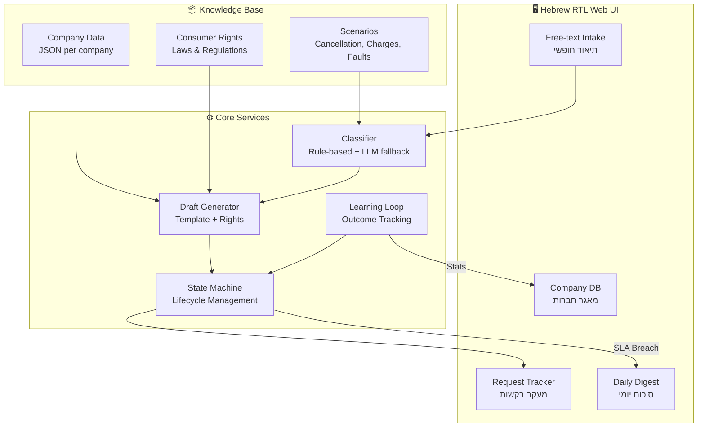
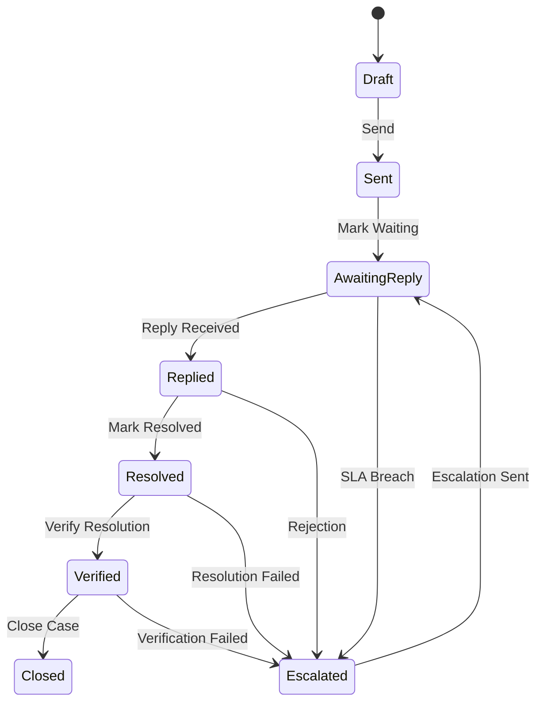

<p align="center">
  
</p>

<h1 align="center">🛡️ IL Consumer Agent</h1>
<h3 align="center">סוכן הצרכן הישראלי</h3>

<p align="center">
  <strong>AI-powered customer service agent for Israelis dealing with large companies</strong>
  <br>
  <em>מטפל בפניות שלך מול חברות גדולות בישראל עד לפתרון מאומת</em>
</p>

<p align="center">
  <a href="https://github.com/Shtibel1/il-consumer-agent/actions/workflows/ci.yml">
    
  </a>
  <a href="https://github.com/Shtibel1/il-consumer-agent/actions/workflows/deploy.yml">
    
  </a>
  <a href="https://github.com/Shtibel1/il-consumer-agent/blob/main/LICENSE">
    
  </a>
  
  
</p>

<p align="center">
  <a href="https://shtibel1.github.io/il-consumer-agent/">🌐 Live Demo</a> •
  <a href="#-quick-start">Quick Start</a> •
  <a href="#-features">Features</a> •
  <a href="#-contributing">Contributing</a>
</p>

---

## ✨ What is IL Consumer Agent?

IL Consumer Agent helps Israeli consumers handle disputes with large companies. Instead of searching for contact details, waiting on hold, or struggling to write effective complaints, this tool:

1. **Classifies your issue** - Tell us what happened in plain Hebrew
2. **Identifies the company** - Automatically detects which company you're dealing with
3. **Drafts your request** - Generates a professional complaint citing relevant consumer rights
4. **Tracks your case** - Follows up until resolution is **verified** (not just promised)
5. **Learns and improves** - Each resolved case improves success rates for everyone

> ⚠️ **Important**: This is a prototype in demo mode. Requests are NOT actually sent to companies. This is not legal advice.

## 🏗️ Architecture



## 🚀 Quick Start

### Prerequisites

- Node.js 22+
- npm 10+

### Installation

```bash
# Clone the repository
git clone https://github.com/Shtibel1/il-consumer-agent.git
cd il-consumer-agent

# Install dependencies
npm install

# Start development server
npm run dev
```

Open [http://localhost:5173/il-consumer-agent/](http://localhost:5173/il-consumer-agent/) in your browser.

### Build for Production

```bash
npm run build
npm run preview
```

### Run Tests

```bash
npm test
```

## 📋 Features

### 🏢 Company Knowledge Base

Open-source, versioned database of 11 major Israeli companies:

| Category | Companies |
|----------|-----------|
| **Telecom** | Cellcom, Partner, Pelephone, HOT, Bezeq |
| **TV** | yes |
| **Utilities** | Israel Electric Corporation |
| **Banking** | Bank Hapoalim, Bank Leumi |
| **Insurance** | Harel, Migdal |

Each company entry includes:
- Contact channels (phone, email, fax, WhatsApp, chat, app)
- Escalation ladder (service → manager → ombudsman → regulator)
- SLA information
- Regulator details
- Source URLs for verification

### 📝 Request Lifecycle



**Key differentiator**: We track cases until resolution is **verified** - confirming that a cancellation actually happened and watching for surprise charges.

### 🎯 Supported Scenarios

- **ביטול שירות** - Service cancellation (with fax support as required by law)
- **חיוב שגוי** - Wrong/duplicate charges
- **תקלה שלא טופלה** - Unresolved technical faults

### 📊 Learning Loop

Every resolved case contributes to:
- Company-specific success rates
- Effective channels per scenario
- Average response times
- Winning arguments and approaches

## 🤝 Contributing

We welcome contributions! The most impactful way to help is by improving the company knowledge base.

### Adding or Updating a Company

1. Create a new JSON file in `src/data/companies/`
2. Follow the schema in existing company files
3. **Important**: Include `sourceUrl` for every piece of information
4. Mark unverified information with `"verified": false`
5. Submit a PR with evidence of your sources

### Company JSON Structure

```json
{
  "id": "company-id",
  "name": "Company Name",
  "nameHe": "שם החברה",
  "industry": "telecom|utilities|banking|insurance|internet|tv",
  "website": "https://...",
  "contactChannels": [
    {
      "type": "phone|email|webform|whatsapp|chat|fax|app",
      "value": "*123",
      "description": "Description",
      "sourceUrl": "https://... (REQUIRED)",
      "verified": true
    }
  ],
  "escalationLadder": [...],
  "slaInfo": [...],
  "regulator": {...}
}
```

### Development Guidelines

1. **Never invent contact details** - all data must have sources
2. **Keep it bilingual** - Hebrew content for users, English for developers
3. **Test your changes** - `npm test` must pass
4. **Follow existing patterns** - consistency is key

## 🗺️ Roadmap

### Phase 1: Prototype (Current)
- [x] Rule-based classification
- [x] Draft generation with legal citations
- [x] Request lifecycle tracking
- [x] Hebrew RTL UI
- [x] 11 major companies

### Phase 2: Real Integration
- [ ] **Real sending with consent** - Actually send requests via email/fax
- [ ] **Email inbox per request** - Dedicated reply-to addresses
- [ ] **WhatsApp updates** - Status notifications via WhatsApp
- [ ] **LLM-powered classification** - Optional OpenAI/Anthropic integration

### Phase 3: Scale
- [ ] **More companies** - Target 50+ companies
- [ ] **Mobile app** - React Native version
- [ ] **Community verification** - Crowdsourced data validation
- [ ] **Success stories** - Public dashboard of resolved cases

### Phase 4: Advanced
- [ ] **Resolution verification** - Automated bank statement monitoring
- [ ] **Class action detection** - Identify patterns across users
- [ ] **Regulatory reporting** - Aggregate complaint data for regulators

## 📊 Cost Tracking

Every case tracks estimated cost (LLM tokens, API calls, human time) to ensure sustainability. Current demo mode has zero external costs.

## ⚖️ Legal Disclaimer

- This tool is **not legal advice**
- Requests are sent **on behalf of and with consent of the customer**
- This tool **never impersonates** a person
- Always verify information before taking action
- See [FTC v. DoNotPay](https://www.ftc.gov/news-events/news/press-releases/2024/09/ftc-takes-action-against-donotpay-providing-artificial-intelligence-lawyer-misleading-consumers) for why we're careful about claims

## 📝 License

MIT License - see [LICENSE](LICENSE) for details.

## 🙏 Acknowledgments

- [כל זכות](https://www.kolzchut.org.il/) - Consumer rights information
- [משרד התקשורת](https://www.gov.il/he/departments/ministry_of_communication) - Telecom regulations
- [בנק ישראל](https://www.boi.org.il/) - Banking supervision
- Israeli consumer protection community

---

<p align="center">
  Made with ❤️ for Israeli consumers
  <br>
  <em>נבנה באהבה עבור צרכני ישראל</em>
</p>
